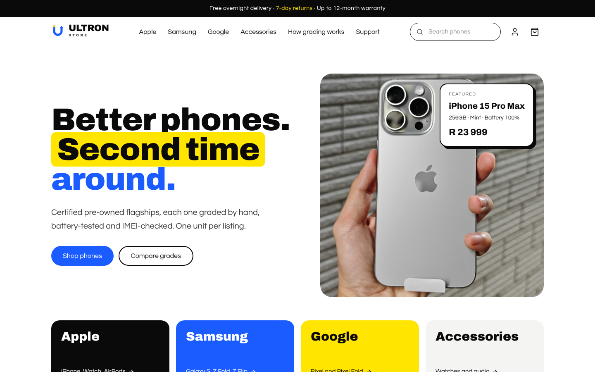
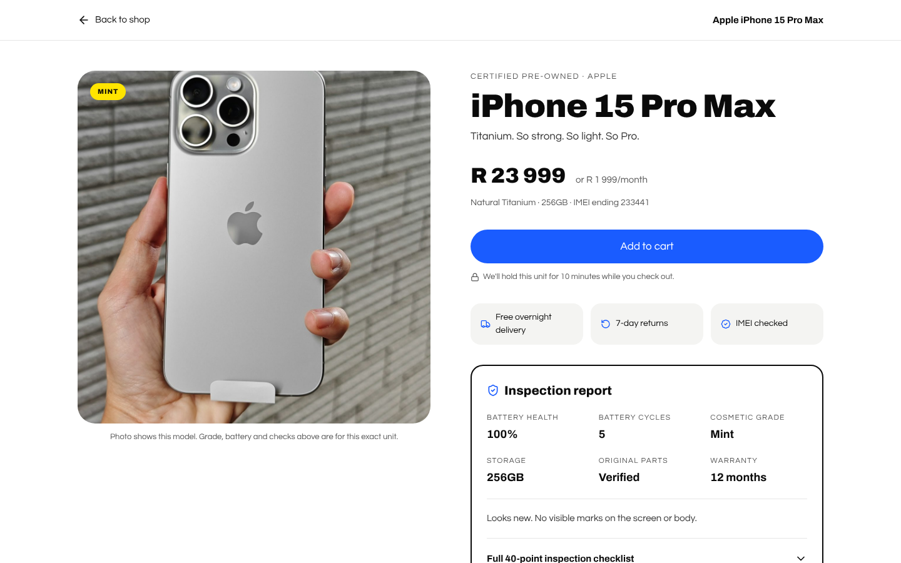
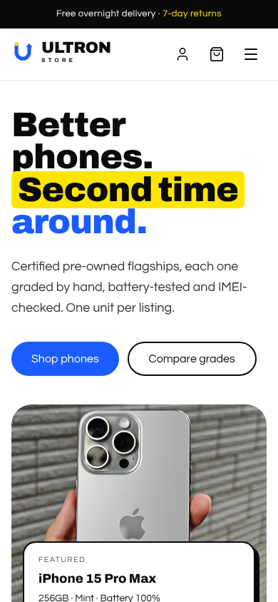
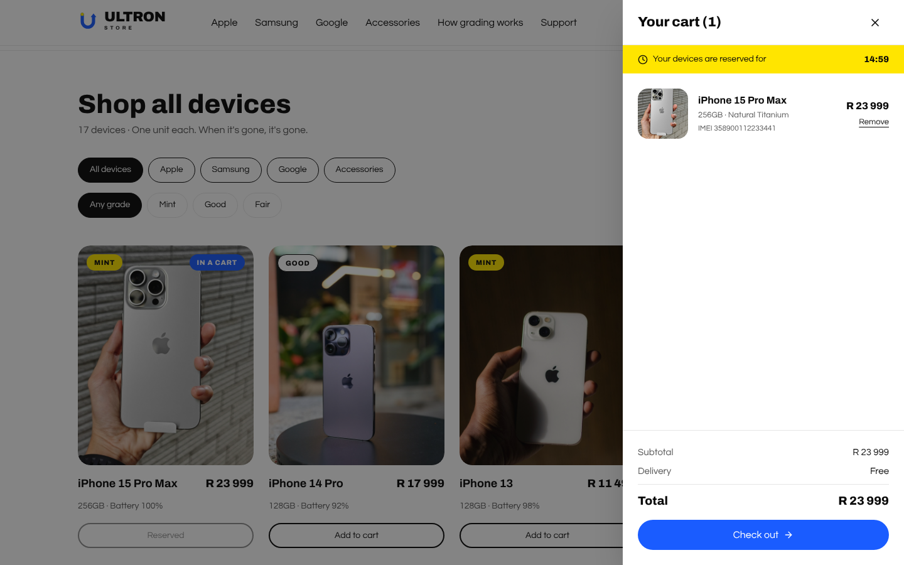

<p align="center">
  
</p>

<p align="center">
  <strong>Certified pre-owned phones, graded by hand, battery-tested and IMEI-checked.</strong><br />
  One unit per listing. When it's gone, it's gone.
</p>

<p align="center">
  
</p>

---

## What ULTRON Store is

ULTRON Store is an e-commerce platform for certified pre-owned and refurbished mobile devices. Most shops sell many copies of one SKU. Here, nearly every listing is a single physical unit, so the platform tracks each device by serial: its IMEI, battery health and cycle count, cosmetic grade (Mint, Good or Fair) and test history.

The repository holds the whole stack:

- a **React storefront** with the customer journey from browsing to checkout
- a **Node.js modular monolith API** for auth, inventory, orders and payments, backed by PostgreSQL
- **Terraform** for Google Cloud infrastructure (VPC, GKE, Cloud SQL, monitoring, security)
- **Helm and ArgoCD** for GitOps delivery to GKE
- **migration runbooks** for moving the on-premise Docker Compose setup to GCP

## The storefront

<table>
  <tr>
    <td width="68%"></td>
    <td width="32%"></td>
  </tr>
  <tr>
    <td>Product page: price, inspection report, specs and 40-point checklist</td>
    <td>Works at phone width</td>
  </tr>
</table>

- **Browse and filter** by brand (Apple, Samsung, Google, accessories), cosmetic grade and search, and sort by price or battery health.
- **Product pages** show battery health and cycles, grade, original-parts status, warranty, specs and the inspection checklist.
- **Stock holds:** adding a device to the cart reserves that unit for the shopper while they check out, with a countdown in the cart.
- **Checkout** covers delivery details and payment (card, instant EFT or crypto), then shows an order confirmation.
- **Accounts:** sign in, register and view order history.
- **Demo mode:** with no backend running, the store uses the built-in catalogue in `frontend/src/data/storeProducts.ts`, so every screen works on its own. The footer link "Connection settings" points it at a live API.

<p align="center">
  
</p>

### Brand and design system

| | |
|---|---|
| **Logo** | "Renew U": the U is a refresh arrow, for a phone getting a second life. Files are in `frontend/public/` (`logo.svg`, `logo-dark.svg`, `logo-icon.svg`, `favicon.svg`), and the React version is `UltronLogo.tsx`. |
| **Colours** | Ink `#0A0A0A`, Sun `#FFE500`, Volt `#1A5CFF`, Paper `#F4F4F2`. Light theme only. |
| **Type** | Archivo (headings, 700 to 900) and Questrial (body), from Google Fonts. |
| **Tokens** | Defined in `frontend/src/index.css` as Tailwind v4 `@theme` values, with shared `.btn`, `.chip`, `.badge` and `.field` styles. |

Product photos live in `frontend/public/products/`, named to match `imageUrl` in the catalogue. The demo catalogue uses stock photos of each model (sources and licences in [`CREDITS.md`](frontend/public/products/CREDITS.md)); swap in photos of the real unit when it's listed. If a photo is missing, the store shows a neutral phone outline.

---

## Architecture

<p align="center">
  
</p>

```text
                         [ Internet clients ]
                                  │
                   [ Cloud Armor WAF / DDoS protection ]
                                  │
                 [ Global external HTTPS load balancer ]
                                  │
             ┌────────────────────┴────────────────────┐
             ▼ static assets                            ▼ API traffic
   [ Cloud Storage + CDN ]                    [ GKE ingress ]
                                                        │
 ── VPC 10.0.0.0/16, private cluster network ──────────┼──────────────
                                                        ▼
                     ┌──────────────────────────────────────────────┐
                     │            GKE autoscaling cluster           │
                     │  Frontend store (React + Vite, served by      │
                     │  Nginx)                                       │
                     │                  │                            │
                     │                  ▼                            │
                     │  Backend API (Node.js modular monolith)       │
                     │  auth · inventory · orders · payment          │
                     └──────────────────────────────────────────────┘
                                        │ private services access
                                        ▼
                     ┌──────────────────────────────────────────────┐
                     │ Cloud SQL, PostgreSQL 15 HA, private IP only  │
                     └──────────────────────────────────────────────┘
```

More detail is in [`docs/`](docs): architecture overview, datastores and patterns, local development, and GitOps deployment. The step-by-step cloud runbook is [`DEPLOYMENT_GUIDE.md`](DEPLOYMENT_GUIDE.md).

## Repository layout

```text
ULTRON-STORE/
├── frontend/                 React 19 + Vite + Tailwind v4 storefront
│   ├── public/               Logo files, favicon, product photos
│   └── src/
│       ├── components/       Layout (header, footer), home sections, cart, product grid and page
│       ├── modules/          Auth, checkout and order history modals
│       ├── data/             Demo product catalogue
│       ├── lib/              Formatting and grade helpers
│       └── index.css         Design tokens and shared styles
├── backend/                  Express API (Node.js) with PostgreSQL
│   └── src/
│       ├── core/db/          Connection pool and schema.sql
│       └── modules/          auth, inventory, orders, payment
├── infrastructure/terraform/ GCP modules: networking, gke, database, monitoring, security
├── gitops/
│   ├── helm/ultron-store/    Helm chart (deployment, HPA, PDB, ingress, network policy)
│   ├── argocd/               ArgoCD project and staging/production applications
│   └── manifests/            Plain Kubernetes manifests with Kustomize
├── migration/                Migration assessment and database validation
├── scripts/migration/        Backup, upload to GCS and Cloud SQL import scripts
├── docs/                     Architecture and operations docs, brand assets, screenshots
├── docker-compose.local.yml  Local stack: Postgres, backend, frontend
├── Makefile                  Developer and DevOps task runner
└── .github/workflows/        CI (PR checks, Trivy scan) and CD (build and GitOps promote)
```

---

## Getting started

### Run the storefront only (fastest)

Needs Node.js 20 or later.

```bash
npm install
npm run dev            # http://localhost:3000, demo mode
```

### Run the full stack locally

Needs Docker with Compose v2.

```bash
docker compose -f docker-compose.local.yml up --build -d
```

| Service | URL |
|---|---|
| Storefront | http://localhost:3001 |
| Backend API | http://localhost:4000/health |
| PostgreSQL | `localhost:5432` (user `appuser`, password `devsecret`, database `ultrondb`) |

The database is initialised from `backend/src/core/db/schema.sql`. Stop everything with:

```bash
docker compose -f docker-compose.local.yml down -v
```

### Useful commands

| Command | What it does |
|---|---|
| `npm run dev` | Start the storefront dev server |
| `npm run build` | Build the storefront for production |
| `npm run dev:backend` | Start the API with auto-reload |
| `npm run lint --workspace=frontend` | Type-check the storefront |
| `make help` | List the Makefile tasks (dev stack, Terraform, ArgoCD sync, image builds) |

---

## Deploying to Google Cloud

The short version is below. [`DEPLOYMENT_GUIDE.md`](DEPLOYMENT_GUIDE.md) has every step.

```bash
# 1. Authenticate
gcloud auth login && gcloud auth application-default login
gcloud config set project YOUR_GCP_PROJECT_ID

# 2. Terraform state bucket
PROJECT_ID=$(gcloud config get-value project)
gsutil mb -p $PROJECT_ID -l us-central1 gs://${PROJECT_ID}-terraform-state
gsutil versioning set on gs://${PROJECT_ID}-terraform-state

# 3. Provision infrastructure
cd infrastructure/terraform
cp environments/dev.tfvars.example environments/dev.tfvars   # then fill it in
terraform init
terraform apply -var-file=environments/dev.tfvars

# 4. Connect to the cluster and install ArgoCD
gcloud container clusters get-credentials ultron-cluster --region us-central1
kubectl create namespace argocd
kubectl apply -n argocd -f https://raw.githubusercontent.com/argoproj/argo-cd/stable/manifests/install.yaml

# 5. Register the app
kubectl apply -f gitops/argocd/applications/staging-app.yaml
```

### CI/CD

- **CI** (`.github/workflows/ci.yml`) runs on pull requests to `main` and `develop`. It validates the Helm chart, builds the backend image and scans it with Trivy for critical and high vulnerabilities.
- **CD** (`.github/workflows/cd.yml`) runs on merges to `main`. It authenticates to GCP and writes the new image tag into `gitops/helm/ultron-store/values-staging.yaml`.
- **ArgoCD** syncs automatically with prune and self-heal turned on, so drift is corrected and a rollback is a `git revert`.

## Security

- Private GKE nodes with outbound traffic through Cloud NAT. Cloud SQL has no public IP.
- Secrets in Google Secret Manager, with Workload Identity for pod access.
- Cloud Armor WAF in front of the load balancer.
- Trivy image scanning on every pull request.
- Kubernetes network policies and pod disruption budgets in the Helm chart.
